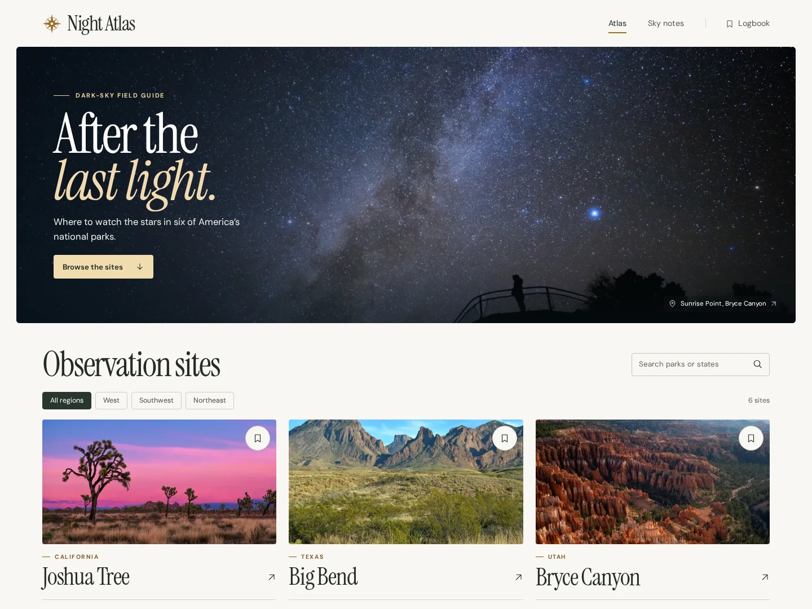

# Night Atlas

A Next.js field guide to stargazing in six U.S. national parks. Find a viewing spot, check the Moon for the night of your trip, and save the places you want to come back to.



## Run with Docker

You need Docker with the Compose plugin. No API keys, database, or account are required.

```sh
git clone https://github.com/alanhoff/nextjs-demo.git
cd nextjs-demo
docker compose up --build --wait
```

Open **[localhost:3000](http://localhost:3000)**. Use `docker compose logs -f` to see the server logs and `docker compose down` to stop it. If port 3000 is busy, run `PORT=3101 docker compose up --build --wait` and open port 3101 instead.

The multi-stage [Dockerfile](Dockerfile) installs from the lockfile, builds with the network disabled, and copies Next’s standalone output into a non-root Node image. The first build needs the internet for npm and the base image. For a public deployment behind a reverse proxy, set `SITE_URL` to the public origin **when building** so prerendered metadata and sitemap URLs point there. Compose publishes only to the loopback interface by default.

## Run without Docker

Use the Node version in [.node-version](.node-version), then:

```sh
npm ci
npm run dev
```

Open [localhost:3000](http://localhost:3000). Edits update the running app. To run the optimized Node build instead, stop the dev server and run `npm run build && npm start`.

## A walk through the App Router

| Try it                                                                                                               | What to look for in the source                                                                                                                                                                                                                                                                                                                          |
| -------------------------------------------------------------------------------------------------------------------- | ------------------------------------------------------------------------------------------------------------------------------------------------------------------------------------------------------------------------------------------------------------------------------------------------------------------------------------------------------- |
| Filter the [site index](http://localhost:3000/#sites) to West, then search for California. Copy the URL or use Back. | [The index](app/page.tsx) reads async search params on the server. Typed links and a GET `next/form` make a view bookmarkable without duplicating filter state in a client store.                                                                                                                                                                       |
| Open [Joshua Tree](http://localhost:3000/sites/joshua-tree).                                                         | [The dynamic segment](app/sites/%5Bslug%5D/page.tsx) generates known params at build time and sets per-park titles, canonical links, and social previews. The [catalog](lib/catalog.ts) uses `use cache` and `cacheLife`; a request-specific bookmark streams into the prerendered page.                                                                |
| Enlarge a park photograph. Press Escape to return. Paste its URL into a new tab.                                     | The [intercepting route](app/@viewer/(.)plates/%5Bslug%5D/page.tsx) fills a parallel slot in the layout with a native dialog. Direct navigation renders the same [photograph](components/plate.tsx) on [its own page](app/plates/%5Bslug%5D/page.tsx).                                                                                                  |
| Bookmark a site, open [Logbook](http://localhost:3000/logbook), then remove it. Try a second browser profile.        | A [Server Action](app/logbook/actions.ts) validates explicit save/remove intents and writes an HTTP-only cookie per park. React’s [request-scoped cache](lib/logbook.ts) deduplicates cookie reads without sharing a visitor’s choices. There is no account or cross-device sync.                                                                       |
| Look up a trip date in [Sky notes](http://localhost:3000/sky-notes).                                                 | The [server fetch](app/sky-notes/phases.ts) gets new, quarter, and full moon times from the U.S. Naval Observatory. A month is a single cache entry. A [Suspense boundary](app/sky-notes/page.tsx) lets the rest of the page render first. If USNO is unreachable, dates in 2026–2028 use a labeled local table; other dates show an unavailable state. |
| Follow [the short code for Big Bend](http://localhost:3000/go/BIBE).                                                 | A narrowly matched [Proxy](proxy.ts) redirects mixed-case park codes to canonical URLs, retaining query parameters. Unknown codes fall through to a 404.                                                                                                                                                                                                |
| Visit an unknown site, inspect a link preview, or open [sitemap.xml](http://localhost:3000/sitemap.xml).             | [Not found](app/not-found.tsx), [error recovery](app/error.tsx), [segment loading UI](app/sites/%5Bslug%5D/loading.tsx), [sitemap](app/sitemap.ts), and [robots](app/robots.ts) use file conventions. The [root layout](app/layout.tsx) self-hosts fonts with `next/font/local`; photos use responsive `next/image`.                                    |
| Read the collection as JSON.                                                                                         | A [GET Route Handler](app/api/sites/route.ts) uses the same data and filter logic as the index. No internal HTTP round trip is needed to render a page.                                                                                                                                                                                                 |

```sh
curl 'http://localhost:3000/api/sites?region=west&q=california'
curl -I 'http://localhost:3000/go/jOtR?from=field-notes'
```

The API returns `{"sites":[...]}`, including an empty array for no matches. Both filters are optional and case-insensitive. `q` searches park and state names (80 characters maximum); `region` accepts West, Southwest, or Northeast. Invalid, repeated, and unknown parameters return HTTP 400 and an `error` message.

Import the [OpenAPI 3.1.1 description](public/openapi.json), served by the app at `/openapi.json`, to discover and call the public API.

For aggregate counts instead of site records, see the [catalog summary API guide](public/guides/catalog-summary.md), served by the app at `/guides/catalog-summary.md`.

See the [route methods guide](public/guides/route-methods.md) for explicit handler exports, including the park redirect and calendar download.

## Verify a change

```sh
npm ci
npm run lint
npm run typecheck
npx playwright install chromium
npm test
```

Playwright starts a development server on port 3100. To exercise the **running Docker image** instead, use `PLAYWRIGHT_BASE_URL=http://127.0.0.1:3000 npm test`. On a bare Linux worker, install the system libraries too: `npx playwright install --with-deps chromium`.

The [CI workflow](.github/workflows/check.yml) lints, type-checks, builds the Docker image, waits for its health check, and runs the browser and HTTP tests against that image. The suite covers filter history, cookie isolation, photo navigation, park-code redirects, invalid requests, and a moon lookup across New Year’s Eve.

The code is [MIT licensed](LICENSE). See [sources and credits](docs/credits.md) for the park photographs, observing guidance, lunar tables, and fonts.
